# 1. Tổng quan ứng dụng

**Giao diện tổng thể:** Digital Video Recorder (DVR-TT01) là một ứng dụng Desktop (Windows) hoạt động với giao diện toàn màn hình, mô phỏng lại trải nghiệm của một thiết bị thu phát video chuyên dụng. Toàn bộ khu vực tương tác được thiết kế tối ưu cho cả thao tác chuột lẫn cảm ứng.

**Khu vực điều khiển trung tâm (Main Workspace):**
1. Khu vực hiển thị Video (Review/Playback) được lồng ghép trực tiếp vào không gian UI.
2. Các cụm phím điều khiển Media cơ bản: Record, Play, Pause, Stop, Seek (Tua đi/Tua lại).

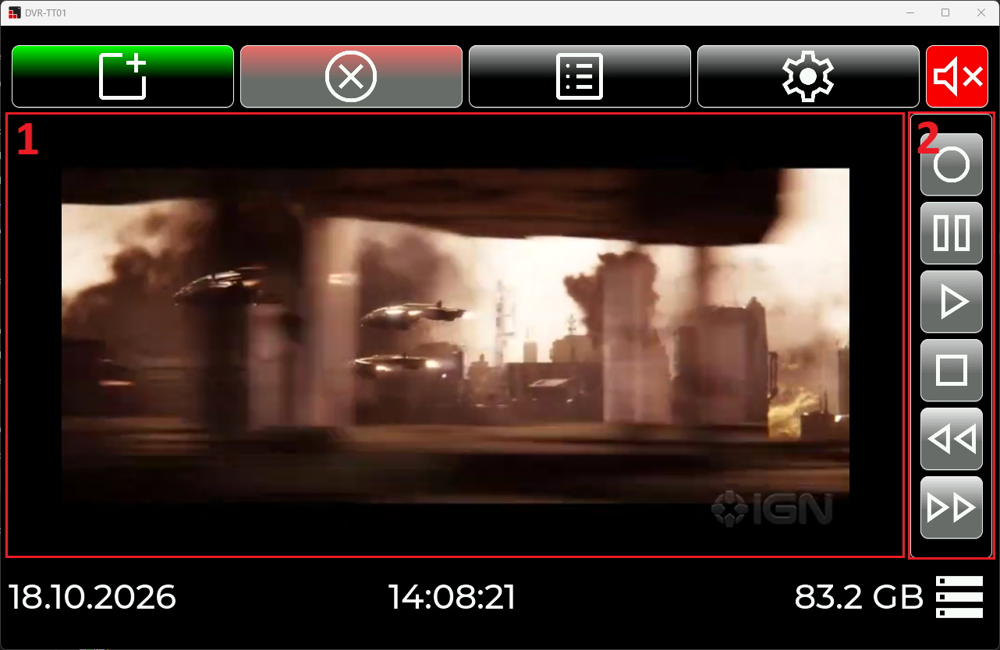

**Khu vực thông tin hệ thống (System Status):**
1. Đồng hồ thời gian thực và Ngày tháng.
2. Thông số dung lượng ổ đĩa lưu trữ nội bộ (Local Storage) và dung lượng ổ đĩa ngoại vi (USB/SD Card) nếu đã kết nối.

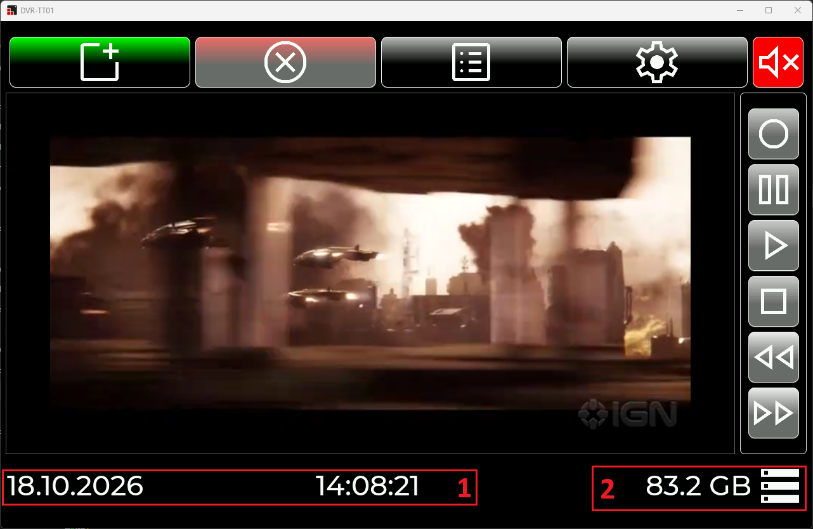

# 2. Phần mềm & Giao diện trên thiết bị

Giao diện người dùng được xây dựng trên nền tảng thư viện đồ họa **LVGL v9** và được thiết kế qua công cụ **SquareLine Studio**. Phần mềm hoạt động dựa trên cơ chế State-driven UI kết hợp Observer Pattern (thông qua `CommonData`) giúp giao diện tự động phản ứng với các thay đổi từ luồng xử lý ngầm (backend).

Kiến trúc phần mềm bao gồm **5 màn hình chính (Screens)** độc lập và các luồng xử lý dịch vụ hệ thống:

## 2.1. Màn hình chính (Main Screen - `ui_Main`)

Là trung tâm điều khiển toàn bộ các hoạt động thu/phát và quản lý trạng thái hệ thống:
- **Thanh công cụ & Phím chức năng:**
1. Nút **New Video** (Tạo phiên ghi hình mới).
2. Nút **Close Video** (Đóng và lưu hồ sơ video đang mở).
3. Nút **Video Record List** (Chuyển sang màn hình quản lý danh sách video đã lưu).
4. Nút **System Setting** (Chuyển sang màn hình cài đặt hệ thống).
5. Nút bật/tắt âm thanh (Mute/Unmute).

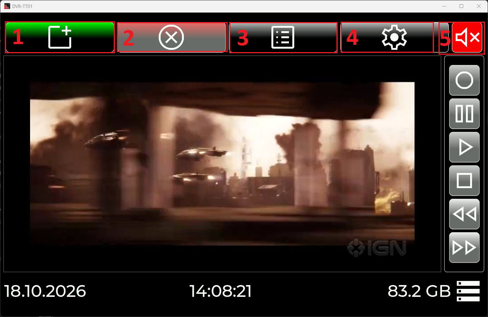

- **Hệ thống điều khiển Media State (FSM):**
  - Các trạng thái `S_STOP`, `S_RECORD`, `S_PLAY`, `S_PAUSE` được giám sát chặt chẽ. Hệ thống sẽ tự động vô hiệu hóa (Disable) các nút bấm không hợp lệ tùy thuộc vào trạng thái hiện tại (VD: Đang Record thì không thể bấm Play).
- **Trình chiếu Video ngầm (Overlay Window):**
  - Khi bắt đầu Play hoặc Record, một cửa sổ FFplay/FFmpeg (xóa viền) sẽ được triệu gọi và chèn đè lên đúng tọa độ khu vực Review của giao diện LVGL. Đi kèm là cơ chế khóa chuột (`ClipCursor`) để bảo vệ luồng video khỏi các thao tác click nhầm.

## 2.2. Màn hình nhập thông tin (Video Input Screen - `ui_VideoInput`)

Xuất hiện khi người dùng muốn bắt đầu một luồng ghi mới, phục vụ việc đóng gói Siêu dữ liệu (Metadata):
- **Trường thông tin chi tiết:** Cho phép người dùng khai báo các thông tin về video bao gồm: Sự kiện (Event), Tên Video (Name), Thể loại (Category), Mô tả (Description), và Tác giả (Author).
- Mỗi video sẽ được cấp một mã định danh duy nhất (GUID) và gán thời gian thực tế (Timestamp) ngay tại thời điểm ghi hình.
- Các thông tin này sau đó được cấu trúc hóa và lưu trữ dưới dạng file INI trong thư mục `video_data/`.

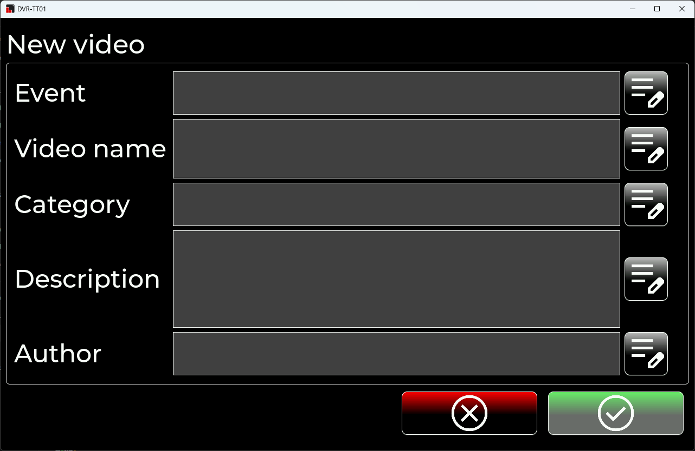

## 2.3. Bàn phím ảo (Keyboard Screen - `ui_Keyboard`)

Do ứng dụng định hướng hoạt động như một thiết bị nhúng độc lập trên màn hình cảm ứng, một bàn phím ảo đầy đủ được thiết kế để hỗ trợ nhập liệu:
- Màn hình chứa widget Keyboard của LVGL, tự động bật lên khi người dùng nhấn vào các ô nhập liệu (Text area) tại màn hình Video Input hoặc Setting.
- Đảm bảo trải nghiệm nhập liệu mượt mà, hỗ trợ các ký tự cơ bản và điều hướng con trỏ.
- Hỗ trợ đa dạng các định dạng bàn phím để phục vụ đa dạng nhu cầu của người dùng, đặc biệt với những trường hợp phải cắm bộ thiết bị bàn phím T9 chuyên dụng.

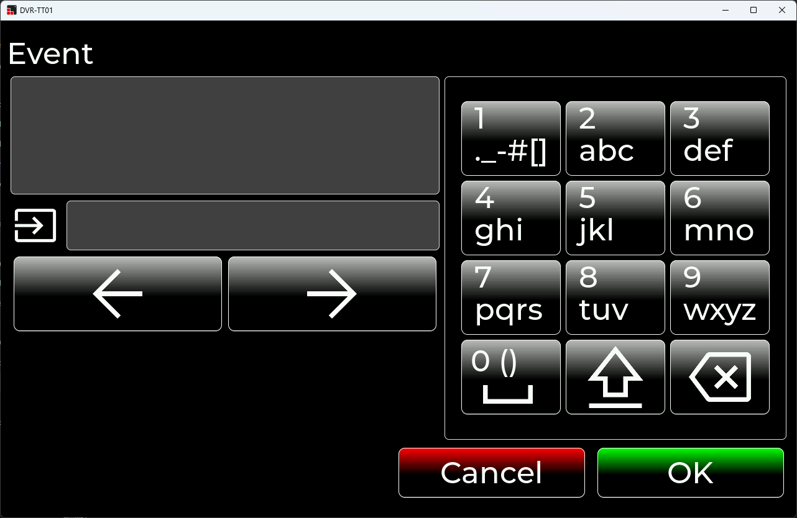

## 2.4. Màn hình Quản lý danh sách Video (Record List Screen - `ui_RecordList`)

Nơi lưu trữ và điều phối toàn bộ các video đã được hệ thống ghi lại:
- **Hiển thị danh sách:** Tự động quét và đọc toàn bộ file cấu hình INI, trình bày danh sách video một cách trực quan cùng với các thẻ thông tin Metadata tương ứng.
- **Tính năng xuất (Export) vật lý:** Hỗ trợ sao chép file video nguyên bản mp4 trực tiếp ra thiết bị USB ngoại vi. Có tích hợp thanh tiến trình Copy và cơ chế xả bộ đệm (`FlushFileBuffers`) an toàn.
- **Tính năng chia sẻ mạng (Network Share):** Tích hợp công cụ đóng gói Python `ndrop`, cho phép gửi trực tiếp tệp video qua môi trường mạng nội bộ (LAN/WiFi) bằng giao thức Dukto.
- **Quản lý dữ liệu:** Hỗ trợ xóa hoàn toàn tệp video và tệp cấu hình tương ứng ra khỏi hệ thống.

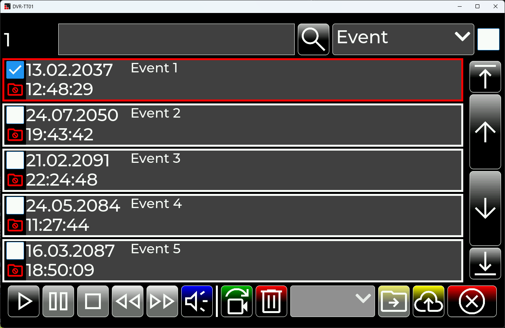

## 2.5. Màn hình Cài đặt Hệ thống (Setting Screen - `ui_Setting`)

Cung cấp các tùy chọn cá nhân hóa và cấu hình giao tiếp mạng cho thiết bị:
- **Cài đặt Chung (General):**
  - **Cài đặt Ngày/Giờ (Date/Time Format):** Tùy chỉnh định dạng ngày (DD/MM/YYYY, MM/DD/YYYY, YYYY/MM/DD) và ký tự phân cách (Dấu chấm, gạch chéo, gạch ngang).
  - **Tùy chọn Video:** Thiết lập chế độ Preview hoặc tự động Play sau khi quay.

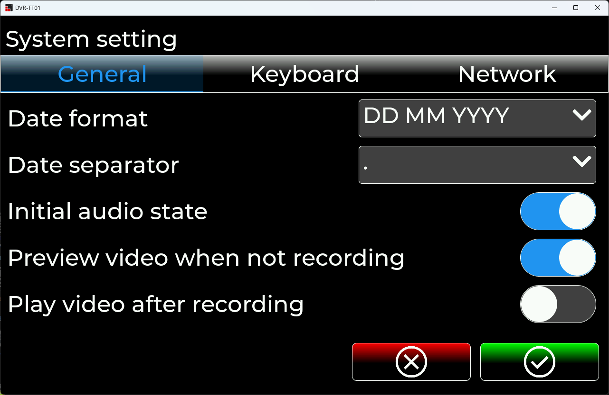

- **Cấu hình Bàn phím (Keyboard):**
  - Standard keyboard: Bàn phím máy tính thông thường (Full phím QWERTY, hoặc các phím tương tự).
  - Standard numpad: Sử dụng cho các bàn phím số kết nối qua USB (Thường gồm 17 phím). Người dùng sẽ sử dụng tổ hợp phím T9 quen thuộc để gõ chữ trên bộ phím số này.
  - Internal numpad: Một bộ phím số đặc biệt được tích hợp trên module phần cứng riêng. Tương tự như Standard numpad, người dùng sử dụng T9 để gõ chữ, nhưng thứ tự của các phím sẽ được định nghĩa lại (re-map) sao cho phù hợp với phần cứng này.
  - Có cài đặt tùy chỉnh tốc độ chuyển đổi T9 (Fast/Normal/Slow). Tích hợp phím Space thông minh (tự động điền phím Space sau khi người dùng điền dấu chấm) và tự động điền ngoặc kết thúc (như tự động điền `]` ngay sau khi nhập `[`).

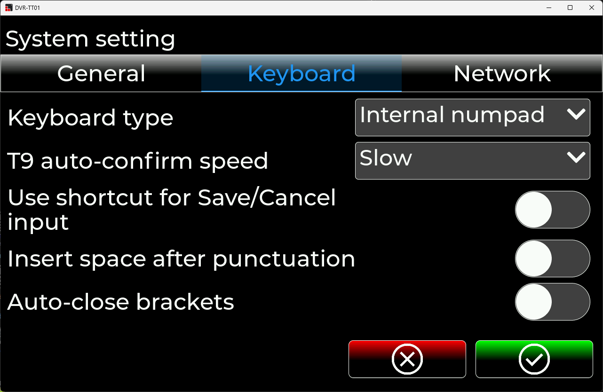

- **Cấu hình Mạng (Network & WiFi):**
  - Hiển thị và chọn bộ chuyển đổi mạng LAN (Network Adapter Dropdown).
  - Tự động quét các trạm phát WiFi (SSIDs) xung quanh thông qua `wlanapi`.
  - Kết nối WiFi trực tiếp trên giao diện: Nhập mật khẩu, hệ thống tự động sinh XML profile và nạp vào Window thông qua `netsh`.

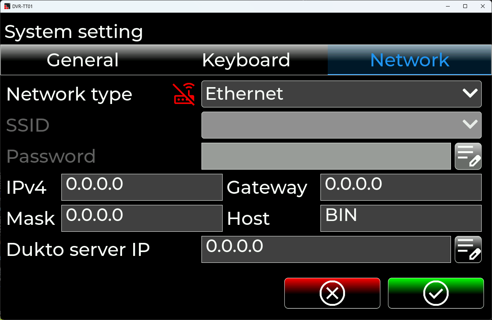

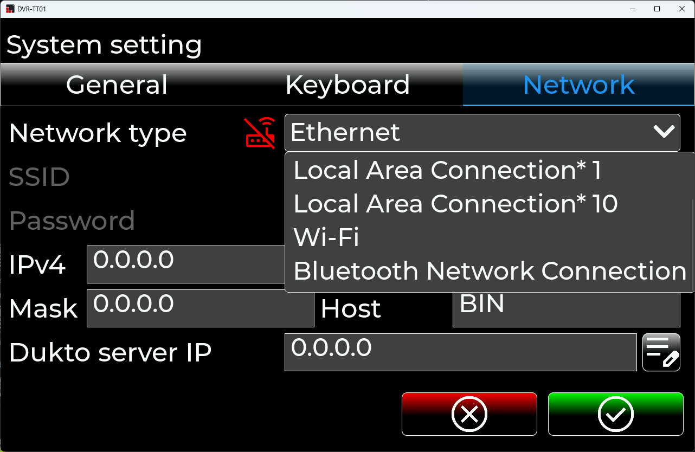

# 3. Hình ảnh thiết bị

- **Mặt trước:**
1. Nút bật/tắt nguồn.
1. Màn hình hiển thị.
2. Bàn phím numpad tích hợp (Internal keyboard).

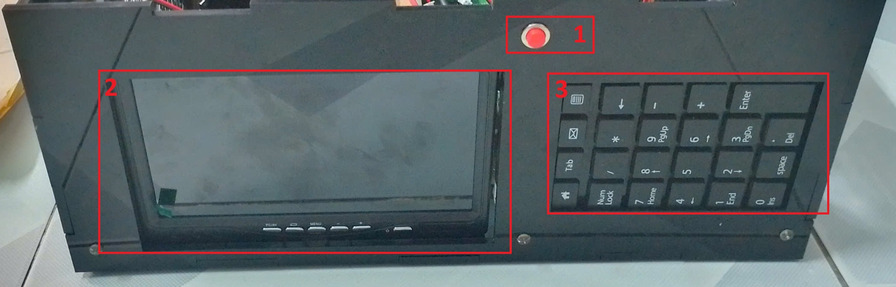

- **Mặt bên hông:**\
Gắn các quạt tản nhiệt thổi không khí nóng ra ngoài.

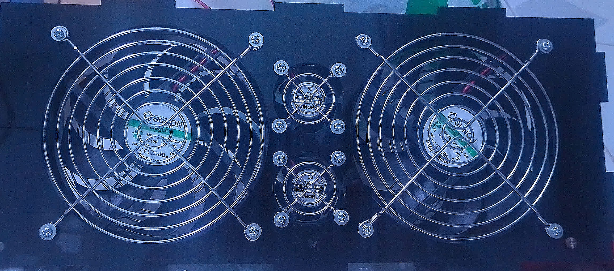

- **Mặt sau:**\
Gắn các quạt tản nhiệt thổi không khí mát từ bên ngoài vào.
Các cổng kết nối thiết bị.
1. **Cổng mạng có dây:** kết nối bằng dây LAN.
2. **Cổng HDMI in:** Kết nối bằng dây HDMI từ thiết bị xuất hình ảnh (PC, laptop, máy chơi game, ...).
3. **Cổng HDMI out:** Kết nối bằng dây HDMI tới thiết bị phát hình ảnh (màn hình, TV, ...). Hình ảnh sẽ được truyền trực tiếp từ HDMI in đến HDMI out.
4. **Núm xoay chỉnh âm lượng:** Chỉnh âm lượng cho các cổng âm thanh đầu ra S1-4.
5. **Núm xoay chọn cổng xuất âm thanh:** Chỉ chọn 1 trong 4 cổng xuất âm thanh từ S1 đến S4.
6. **Cổng USB hub:** Kết nối các ngoại vi công suất thấp như USB, SD card, chuột, bàn phím, ...
7. **Màn hình cảm ứng ngoại vi:** *Hiện tại chưa được phát triển chức năng.*
8. **Lỗ cắm được AC và công tắc nguồn điện.**

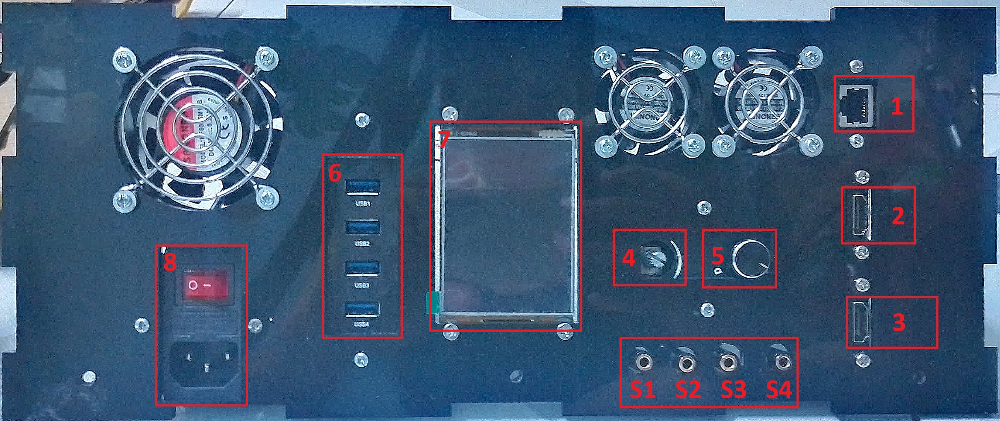

# 4. Ưu/Nhược điểm, hướng phát triển của ứng dụng
## 4.1. Ưu điểm
- **Giao diện hiện đại & Siêu nhẹ:** Ứng dụng LVGL Desktop mang lại độ phản hồi cực kỳ nhanh nhạy, tiêu tốn ít RAM so với các framework đồ họa Desktop truyền thống như Electron hay WPF.
- **Kiến trúc Tách biệt (Decoupled):** Sử dụng triệt để cơ chế Global Data (Observer pattern), giúp phần UI không bị dính líu (coupled) trực tiếp tới các tác vụ xử lý nặng.
- **Tích hợp Media thông minh:** Gọi trực tiếp FFmpeg CLI qua tiến trình phụ giúp không làm phình to ứng dụng bởi các thư viện C/C++ giải mã video phức tạp, dễ dàng cập nhật phiên bản FFmpeg.
- **Hỗ trợ phần cứng chuyên dụng:** Tích hợp tính năng nhận diện cắm/rút USB tự động, kết nối WiFi độc lập và chặn/hook tín hiệu phím cứng (Hardware Keyboard) ở mức hệ điều hành.

## 4.2. Nhược điểm
- **Tác vụ đồng bộ làm nghẽn UI (Blocking I/O):** Một số luồng xử lý như đọc hàng loạt file cấu hình INI (danh sách video) hoặc quét/chờ kết nối mạng WiFi đang được thực thi trực tiếp trên Main Thread, có khả năng gây đơ (freeze) giao diện nếu dữ liệu quá lớn hoặc mạng phản hồi chậm.
- **Quản lý tiến trình (Process) khá thô:** Việc dừng luồng ghi Video bằng cách tìm kiếm Window của tiến trình ngầm (FindWindow) và gửi phím tắt mô phỏng (`keybd_event` phím 'Q') hoặc sử dụng lệnh `taskkill` mang tính chắp vá, tiềm ẩn rủi ro lỗi nếu mất focus hoặc tên tiến trình thay đổi.

## 4.3. Hướng phát triển
- **Đa luồng (Multi-threading):** Đưa các tác vụ Disk I/O (load danh sách video) và Network (dò WiFi, copy Dukto) sang chạy trên `std::thread` hoặc Worker Threads để đảm bảo UI LVGL luôn duy trì ở mốc 60-100 FPS mượt mà.
- **Cải tiến tương tác tiến trình:** Thay thế `ShellExecute` bằng `CreateProcess` kết hợp với **Named Pipes (IPC)** để giám sát trực tiếp Standard Output/Input của FFmpeg, cho phép điều khiển video và lấy thông tin thời lượng phát chuẩn xác, loại bỏ hoàn toàn cơ chế mô phỏng phím bấm.
- **Bảo mật:** Nâng cấp cơ chế kết nối WiFi, không lưu trữ thông tin mật khẩu dưới định dạng file XML tạm thời trên ổ cứng nhằm đề phòng rủi ro lộ lọt dữ liệu khi ứng dụng crash.
