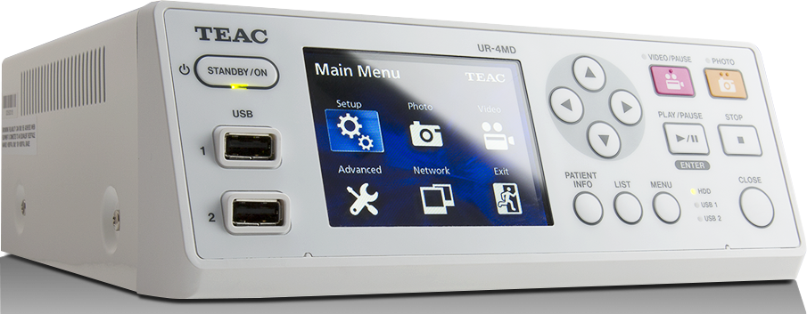
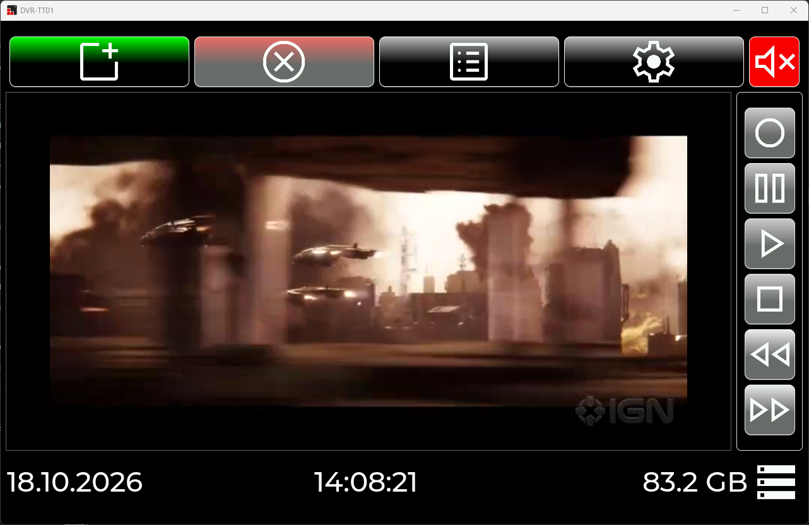
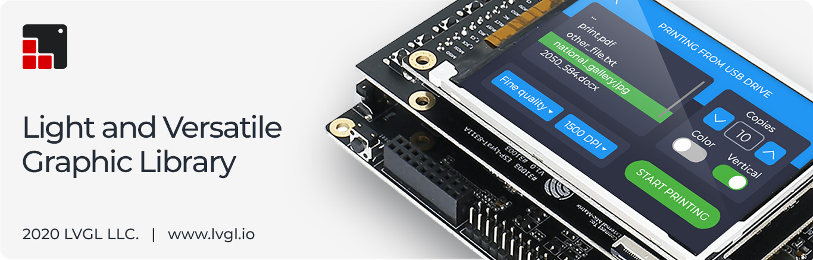

# 1. Tổng quan
## 1.1. Digital Video Recorder (DVR-TT01)
Digital Video Recorder (DVR-TT01) là một hệ thống phần mềm quản lý, ghi hình và phát lại video chuyên dụng được thiết kế tối ưu trên nền tảng Windows Desktop. Khác biệt với các phần mềm media thông thường, DVR-TT01 mang đến một trải nghiệm nguyên khối (all-in-one) từ việc thu phát tín hiệu, biên tập siêu dữ liệu (metadata), cho đến xuất tệp vật lý và truyền tải mạng không dây.

> Máy Medical Imaging Recorder - nguồn cảm hứng tạo ra dự án \
[Tìm hiểu thêm](https://ms.teac.com/products/ur-4md/)

Điểm nhấn cốt lõi của dự án:
- **Giao diện mượt mà & Hiện đại:** Sử dụng sức mạnh của LVGL (Light and Versatile Graphics Library) để tạo ra một giao diện State-driven UI phản hồi tức thời, loại bỏ sự cồng kềnh của các native UI framework truyền thống.
- **Tích hợp FFmpeg nguyên bản:** Không cần nhúng các thư viện giải mã khổng lồ làm phình to ứng dụng, DVR-TT01 gọi trực tiếp FFmpeg/FFplay thông qua Shell/PowerShell, sau đó sử dụng kỹ thuật can thiệp Win32 API sâu để "nhúng" luồng video vào thẳng giao diện ứng dụng.
- **Lưu trữ & Truyền tải thông minh:** Hỗ trợ nhận diện USB tự động, xuất video an toàn, cùng tính năng chia sẻ mạng LAN qua giao thức Dukto (ndrop) đầy mạnh mẽ.

## 1.2. Các tính năng cốt lõi
Trong hệ thống DVR-TT01, mọi tính năng đều được module hóa và giám sát chặt chẽ thông qua các luồng xử lý ngầm. Dưới đây là kho tính năng cốt lõi tạo nên sức mạnh của hệ thống:

- **Ghi & Phát Video (Record / Playback):** Sử dụng sức mạnh của FFmpeg CLI. Ứng dụng tự động tạo ra một cửa sổ console ngầm, tước bỏ viền cửa sổ (border/caption), ép nó trở thành một đối tượng con (child window) và chèn đè lên trên vùng xem trước (Preview) của LVGL.
- **Bảo vệ chống tương tác sai (Anti-click / Mouse Restrict):** Để ngăn người dùng vô tình tương tác hoặc click vào luồng video FFplay đang đè lấp, ứng dụng kích hoạt thuật toán dùng `ClipCursor` để khóa giới hạn chuột khi video đang phát.
- **Quản lý Thông tin Video (Metadata Management):** Mỗi video được gán một mã GUID duy nhất và lưu trữ trong cấu trúc thư mục riêng biệt kèm file cấu hình INI (chứa thông tin Tên, Tác giả, Sự kiện, Thể loại, Thời gian stamp).
- **Xuất tệp ra USB nhanh chóng:** Tự động dò tìm ổ đĩa ngoại vi (Removable Drives). Chức năng copy hiển thị thanh tiến trình chuẩn xác theo callback của hệ điều hành, và ép bộ đệm (`FlushFileBuffers`) để chống mất dữ liệu khi rút USB đột ngột.
- **Truyền tải Không dây (Dukto Network):** Tích hợp công cụ Python nhúng để đóng gói dữ liệu và gửi thẳng qua mạng LAN/WiFi bằng giao thức Dukto, cho phép chia sẻ video mượt mà giữa các thiết bị.
- **Cấu hình WiFi Tự động:** Tích hợp Native Wifi API (`wlanapi`), cho phép quét SSIDs, và tự động tạo XML Profile để kết nối thiết bị với các mạng WiFi mong muốn ngay trong giao diện ứng dụng.

## 1.3. Nền tảng Windows Desktop & Tích hợp Hệ thống
Dự án này là một phiên bản phần mềm độc lập được biên dịch trên kiến trúc x64 dành cho Windows. Thay vì sử dụng phần cứng vi điều khiển, dự án tận dụng tối đa sức mạnh của hệ điều hành Microsoft Windows thông qua các API mức thấp (Low-level Win32 API).

### **Cơ chế Hook Bàn phím Cứng (Hardware Keyboard Hook)**
Hệ thống không chỉ điều khiển bằng chuột/cảm ứng mà còn hỗ trợ bàn phím vật lý chuyên dụng. Thông qua thủ thuật Window Procedure Subclassing (`MyNewWinProc`), các tín hiệu phím đa phương tiện (AppCommand, Volume Mute, Play/Pause) và các phím điều hướng (F1-F4) được đánh chặn ở mức hệ thống (LowLevelKeyboardProc) và dịch thành sự kiện `LV_EVENT_KEY` để điều hướng UI, giúp ứng dụng có thể hoạt động như một cỗ máy DVR phần cứng thực thụ.

### **Xử lý tiến trình ngoại vi (Process Management)**
Trái tim của hệ thống là khả năng quản lý tiến trình. Ứng dụng tự động khởi chạy và điều phối các tệp tin `record.bat`, `play.bat`, `review.bat`. Bằng cách mô phỏng các phím ảo (như phím 'Q' để tắt luồng ghi an toàn, phím mũi tên để tua video), ứng dụng biến các công cụ dòng lệnh khô khan thành một module media tích hợp hoàn hảo.

## 1.4. LVGL & SquareLine Studio
Giao diện người dùng của dự án được phát triển bằng **LVGL (Light and Versatile Graphics Library)**, kết hợp cùng công cụ thiết kế giao diện trực quan **SquareLine Studio**.

Điểm mạnh cốt lõi của giải pháp này:
- **State-driven UI:** LVGL kết hợp với môi trường Windows tạo ra một Desktop Application siêu nhẹ. Việc hiển thị được cập nhật liên tục qua bộ định thời (`lv_timer_handler`).
- **Thư viện Widget phong phú:** Hỗ trợ đầy đủ các tính năng như Bàn phím ảo (Keyboard), Danh sách cuộn (Roller/Dropdown), Nút bấm đa trạng thái.
- **Phát triển trực quan:** SquareLine Studio cho phép thiết kế layout, quản lý assets hình ảnh/font chữ xuất ra file ngôn ngữ C chuẩn mực (`ui.c`, `ui.h`), dễ dàng tích hợp chéo (cross-platform) lên nền tảng C++ Visual Studio của dự án.

# 2. Phần mềm & Kiến trúc hệ thống
Dự án được xây dựng dựa trên kiến trúc **Observer / Singleton Pattern** kết hợp **MVC/Presenter**, thiết kế để tách biệt rõ ràng trách nhiệm giữa việc hiển thị giao diện, quản lý trạng thái, và các luồng xử lý phần mềm ngầm. Cấu trúc mã nguồn được chia thành các tầng lõi sau:

## **1. GUI (Tầng Giao Diện - `ui/`)**
- **Trách nhiệm:** Đảm nhiệm toàn bộ khía cạnh hiển thị đồ họa sinh tự động từ SquareLine Studio.
- **Chức năng:** Định nghĩa bố cục tĩnh cho các màn hình: `ui_Main` (Màn hình làm việc chính), `ui_VideoInput` (Nhập metadata), `ui_RecordList` (Quản lý và xuất video), `ui_Setting` (Cài đặt hệ thống), `ui_Keyboard` (Bàn phím ảo). Các file này hoàn toàn không chứa logic nghiệp vụ, chỉ có các hàm callback rỗng.

## **2. VIEW (Tầng Điều hướng & Trình diễn - `View/`)**
- **Trách nhiệm:** Là lớp Controller/Presenter kết nối giữa đồ họa LVGL (UI) và Dữ liệu hệ thống.
- **Chức năng:**
  - Lớp `ScreenMapping` (dạng Singleton) đóng vai trò trung tâm điều phối, map tên màn hình với các hàm tạo (Factory), cho phép chuyển đổi màn hình động và xử lý event an toàn bộ nhớ.
  - Các lớp như `MainScreen`, `SettingScreen` kế thừa từ `BaseScreen`, định nghĩa lại các Callback, lắng nghe sự kiện nút bấm và gọi các hàm thực thi nghiệp vụ tương ứng.

## **3. DATA (Tầng Lưu Trữ Dữ liệu - `Library/CommonData/`)**
- **Trách nhiệm:** Lưu trữ trạng thái toàn cục của hệ thống (Global States).
- **Chức năng:** 
  - Ứng dụng lớp template `CommonDataType` mang hơi hướng Observer pattern. Các thông số như IP mạng, dung lượng ổ đĩa, thông tin metadata tạm thời, % copy file, và FSM states (`S_STOP`, `S_RECORD`, `S_PLAY`) đều được bọc trong các đối tượng an toàn.
  - Khi dữ liệu thay đổi dưới background, hàm `DataUpdateOperator` ở tầng View sẽ tự động cập nhật lại giao diện (Ví dụ: Disable nút Record nếu đang Play).

## **4. LIB (Tầng Xử lý Nghiệp vụ & Dịch vụ - `Library/`)**
- **Trách nhiệm:** Xử lý logic cứng và tương tác với các API của hệ điều hành Windows.
- **Chức năng:**
  - `VideoRecordLibrary`: Bao bọc toàn bộ kỹ xảo Windows API thao tác với FFmpeg (SetWindowLongPtr, ClipCursor, ShellExecute).
  - `NetworkLibrary`: Sử dụng `IPHLPAPI.lib` và `wlanapi.lib` để trích xuất IP, Gateway, tạo XML kết nối mạng không dây và đẩy lệnh tới Python (ndrop).
  - `StorageLibrary`: Gọi hàm Win32 lấy danh sách phân vùng ổ đĩa di động (`DRIVE_REMOVABLE`), theo dõi tiến trình copy bất đồng bộ.
  - `VideoInfoLibrary`: Lưu và trích xuất cấu trúc dữ liệu (`videoinfo_t`) vào tệp cấu hình (INI format) tại không gian lưu trữ hệ thống.

## **5. SIM (Hệ thống Chính - `LvglWindowsDesktopApplication`)**
- **Trách nhiệm:** Điều hành quản lý vòng đời ứng dụng.
- **Chức năng:** File `LvglWindowsDesktopApplication.cpp` chứa hàm `wWinMain` tạo màn hình cho LVGL, khởi chạy các module hệ thống, thiết lập cơ chế phát hiện crash dump (`OurCrashHandler`/`MiniDumpWriteDump`) đảm bảo ứng dụng không chết chìm không để lại dấu vết. Nơi đây cũng chạy vòng lặp chính của toàn bộ chương trình (`lv_timer_handler`).

### **Lợi ích của Kiến trúc này:**
- **Triệt tiêu Data-Coupling:** Giao diện LVGL hoàn toàn không biết về FFmpeg hay Win32 API. Tầng View chịu trách nhiệm lắng nghe UI và báo cáo cho Tầng Data/Lib.
- **Quản lý đa luồng an toàn:** Các tiến trình ngoại vi (Copy USB, Call Python, FFmpeg Process) không làm treo cứng giao diện đồ họa.
- **Dễ dàng bảo trì và mở rộng:** Việc thêm một phần cứng mới hoặc một định dạng Video mới chỉ cần sửa đổi ở tầng `Library`, các tầng khác giữ nguyên kiến trúc.

# 3. Sản phẩm hoàn thiện
Chi tiết về sản phẩm đã hoàn thiện cùng hình ảnh và hướng dẫn sử dụng các màn hình, xem tại [PRODUCT.md](PRODUCT.md)
